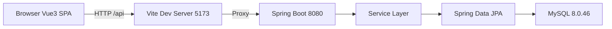
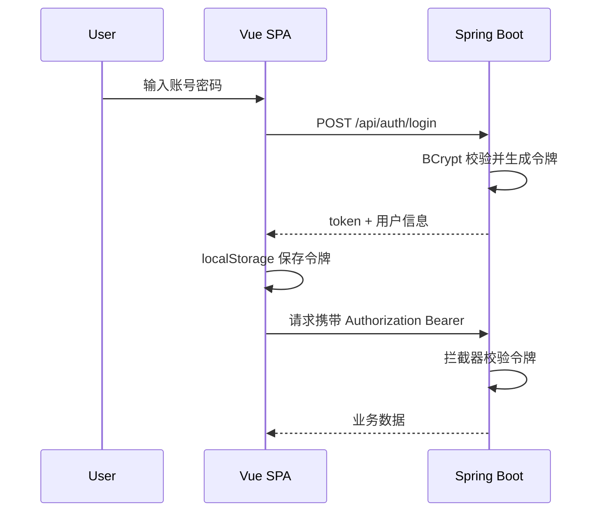

# 架构设计

## 系统概述

系统采用前后端分离架构。Vue 3 单页应用运行在浏览器中，通过 HTTP 调用 Spring Boot 提供的 REST API；后端通过 Spring Data JPA 访问 MySQL 8.0.46。开发环境下 Vite 开发服务器将 `/api` 请求反向代理到后端 8080 端口，从而只暴露单一预览端口。

## 技术栈

- 前端：Vue 3.4、Vite 5、Vue Router 4、Pinia 2、Element Plus 2、Axios 1
- 后端：Java 17、Spring Boot 3.2.5、Spring Web、Spring Data JPA、Bean Validation、spring-security-crypto
- 数据库：MySQL 8.0.46，字符集 utf8mb4
- 构建：Maven 3.8、npm 10

## 项目结构

```
/workspace
├── backend/                      # Spring Boot 后端
│   ├── pom.xml
│   └── src/main/java/com/pyq/tcm
│       ├── TcmApplication.java
│       ├── common/               # 统一响应、异常处理
│       ├── config/               # 拦截器、初始化数据
│       ├── auth/                 # 登录与令牌
│       ├── entity/               # JPA 实体
│       ├── repository/           # 数据访问
│       ├── service/              # 业务逻辑
│       └── controller/           # REST 接口
├── frontend/                     # Vue 3 前端
│   ├── package.json
│   ├── vite.config.js
│   └── src
│       ├── api/                  # Axios 封装
│       ├── stores/               # Pinia
│       ├── router/
│       ├── layout/
│       └── views/
├── sql/schema.sql                # 表结构参考脚本
└── .monkeycode/                  # 项目文档与规格
```

## 核心模块

| 模块 | 职责 |
|------|------|
| AuthModule | 登录校验、令牌签发与校验、当前用户信息 |
| ProjectModule | 项目 CRUD 与检索 |
| ModuleModule | 项目内多级模块树维护 |
| TestCaseModule | 用例 CRUD、多条件筛选、分页 |
| TestPlanModule | 计划 CRUD、计划内用例清单、执行记录、统计 |
| DashboardModule | 全局统计聚合 |

## 架构图



## 认证流程



## 关键流程

### 用例维护
1. 用户选择项目，系统加载模块树与用例列表。
2. 新建用例时填写标题、优先级、类型、步骤（动作 + 预期）。
3. 后端校验必填项并生成用例编号，保存至 `test_cases`。

### 计划执行
1. 创建测试计划，系统按计划关联项目的全部用例（执行记录按需生成）。
2. 执行页逐条提交结果，后端以 `(plan_id, case_id)` 为唯一键做插入或更新。
3. 统计接口返回各状态数量与通过率。

## 设计决策

| 决策 | 说明 |
|------|------|
| 使用 OpenJDK 17 | 环境无法访问 Oracle 官方下载源；OpenJDK 17 与 Oracle JDK 17 在语言与运行时层面兼容 |
| 令牌存于服务端内存 | 单实例演示场景足够；生产可替换为 JWT 或 Redis |
| 用例步骤存为 JSON 列 | 步骤结构简单且随用例整体读写，避免额外关联表 |
| 使用数据库自增主键 | 简化关联，无需分布式 ID |
| 前端反向代理 | 预览环境仅暴露一个端口，同时规避浏览器跨域 |
