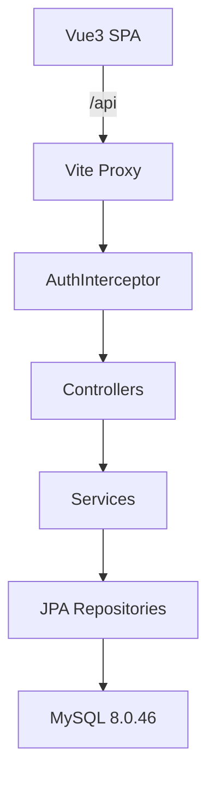
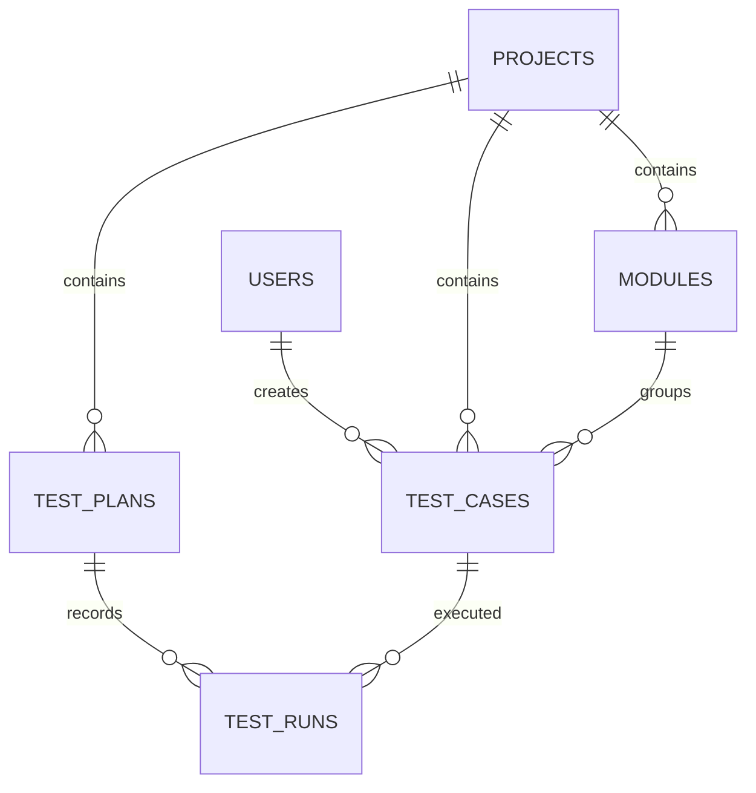

# 测试用例管理系统 技术设计

Feature Name: testcase-management
Updated: 2026-10-24

## 描述

系统为前后端分离的测试资产管理系统。后端基于 Spring Boot 3.2.5 提供 REST API，使用 Spring Data JPA 持久化到 MySQL 8.0.46；前端基于 Vue 3 + Element Plus，通过 Vite 代理访问后端。认证采用服务端内存令牌 + BCrypt 密码哈希。

## 架构

## 组件与接口

| 组件 | 职责 |
|------|------|
| AuthController / AuthService / TokenStore | 登录、当前用户、登出、令牌校验 |
| ProjectController / ProjectService | 项目分页与 CRUD |
| ModuleController / ModuleService | 模块树查询与 CRUD，删除前校验引用 |
| TestCaseController / TestCaseService | 用例分页、CRUD、编号生成 |
| TestPlanController / TestPlanService | 计划 CRUD、计划用例视图、执行提交、统计 |
| DashboardController | 聚合统计 |
| AuthInterceptor | 校验 `Authorization` 头，放行登录接口与 CORS 预检 |
| GlobalExceptionHandler | 统一异常到 `ApiResponse` 的转换 |

## 数据模型

### 表结构

- `users(id, username, password, nickname, role, created_at)`
- `projects(id, name, code, description, status, created_at)`
- `modules(id, project_id, parent_id, name, sort_order, created_at)`
- `test_cases(id, project_id, module_id, case_no, title, priority, type, status, precondition, steps, tags, creator, created_at, updated_at)`
- `test_plans(id, project_id, name, description, status, start_date, end_date, created_by, created_at)`
- `test_runs(id, plan_id, case_id, status, executor, remark, executed_at)`，唯一键 `(plan_id, case_id)`

`steps` 以 JSON 文本存储，结构为 `[{ "action": "...", "expected": "..." }]`，由 `StepsConverter` 负责序列化。

## 正确性属性

1. 任意需要认证的请求，缺少有效令牌时必须返回 401。
2. 同一计划下同一用例最多存在一条执行记录。
3. 删除项目时若存在子模块或用例，必须失败且不产生部分删除。
4. 用例编号在项目内唯一，格式 `TC-<项目编码>-<序号>`。
5. 通过率 = 通过数 / 已执行数 × 100，已执行数为 0 时返回 0。

## 错误处理

| 场景 | HTTP | 业务码 | 处理 |
|------|------|--------|------|
| 账号或密码错误 | 401 | 401 | 提示统一文案，避免泄露账号是否存在 |
| 令牌缺失或过期 | 401 | 401 | 前端清除令牌并跳转登录页 |
| 参数校验失败 | 400 | 400 | 返回首个字段错误信息 |
| 资源不存在 | 404 | 404 | 返回"记录不存在" |
| 引用约束冲突 | 400 | 400 | 返回具体原因 |
| 未预期异常 | 500 | 500 | 记录日志，返回通用错误 |

## 测试策略

- 后端：对 Service 层进行单元测试，覆盖唯一键更新、删除约束与统计计算；使用 MockMvc 验证认证拦截与参数校验。
- 前端：以人工冒烟为主，覆盖登录、项目 CRUD、用例 CRUD、计划执行与仪表盘展示。
- 集成：启动 MySQL 后执行 `mvn test` 与前端构建，确认接口联通。

## 参考资料

[^1]: Spring Boot 3.2 Reference - https://docs.spring.io/spring-boot/docs/3.2.x/reference/html/
[^2]: Vue 3 文档 - https://cn.vuejs.org/guide/
[^3]: Element Plus 文档 - https://element-plus.org/zh-CN/
